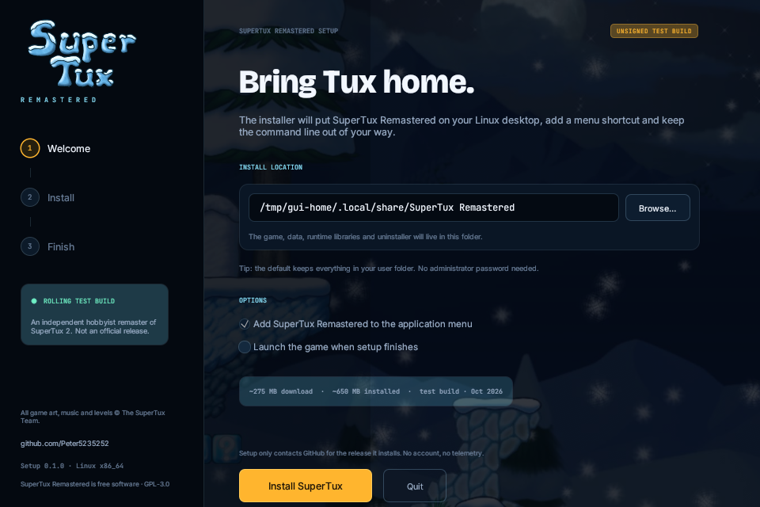

# SuperTux Remastered Setup (Linux)

A real graphical installer for the rolling Linux test build. One small binary,
no terminal, no distro-specific package manager, no sudo by default.



## What it does

1. Resolves the current `test-build` release through the GitHub API.
2. Downloads `supertux-remastered-linux-portable.tar.gz` with a progress view.
3. Verifies the SHA-256 digest published by GitHub for that release asset.
4. Unpacks the game into `~/.local/share/SuperTux Remastered` (configurable).
5. Bundles SDL3_image and SDL3_ttf so the portable build starts on systems that
   only have the base SDL3 package.
6. Adds an application-menu entry, an icon, a `supertux-remastered` wrapper in
   `~/.local/bin`, and an `uninstall.sh` inside the install folder.
7. Optionally launches the game.

It never asks for an administrator password and never writes outside the chosen
folder, `~/.local/share/applications`, `~/.local/bin`, and the game's normal save
directory (`~/.local/share/supertux2`).

## Build

```sh
cd installer
cargo build --release
```

The result is `target/release/supertux-remastered-setup` (about 10 MB). Runtime
needs: a Linux desktop, Vulkan-capable GPU/driver, SDL3, OpenAL and the Vulkan
loader. The game ships its own SDL3_image/SDL3_ttf.

## CLI fallback

```sh
# graphical installer (default)
./supertux-remastered-setup

# terminal install, the same verified pipeline
./supertux-remastered-setup --cli \
  --prefix "$HOME/.local/share/SuperTux Remastered"

# replace an installation, skip the menu shortcut
./supertux-remastered-setup --cli --no-shortcut --prefix /path/to/SuperTux

# remove it (keeps saves in ~/.local/share/supertux2)
./supertux-remastered-setup --uninstall \
  --prefix "$HOME/.local/share/SuperTux Remastered"
```

`--help` lists every option.

## Notes

- The release is a rolling test build. The installer is not signed; the binary
  and its SHA-256 are published next to it on the website.
- The GitHub API digest is authoritative for the download. If the API is rate
  limited, the installer falls back to the direct release URL and logs that no
  published digest was available.
- The installer bundles SDL3_image 3.4.8 and SDL3_ttf 3.2.2 builds from Arch
  Linux. Both are zlib-licensed. See `THIRD_PARTY_NOTICES.md`.
- The game itself is GPL-3.0-or-later; data is CC-BY-SA. See the repository root
  for attribution and the AI disclosure.

To rebuild the website download and checksum after changing the installer:

```sh
./package.sh
```
